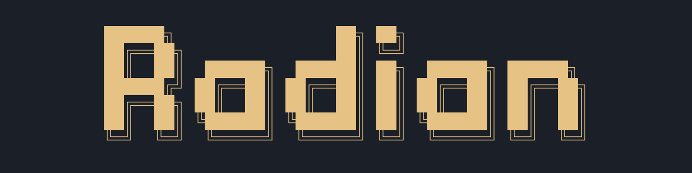

<!-- GitHub theme fragments follow site appearance even when it differs from the system theme. -->
<h1 align="center">
  <a href="assets/radian-banner-dark.png#gh-dark-mode-only"></a>
  <a href="assets/radian-banner.png#gh-light-mode-only"></a>
</h1>

<p align="center">
  <strong>A keyboard-first AI workbench for your terminal.</strong><br>
  Pi agents, your Neovim setup, Git, and terminals — organized by worktree.
</p>

<p align="center">
  <a href="#getting-started">Get started</a> ·
  <a href="#keybindings">Keybindings</a> ·
  <a href="#configuration">Configuration</a> ·
  <a href="docs/reference.md">Reference</a>
</p>

<p align="center">
  <a href="package.json#gh-dark-mode-only"></a>
  <a href="package.json#gh-light-mode-only"></a>
  <a href="LICENSE#gh-dark-mode-only"></a>
  <a href="LICENSE#gh-light-mode-only"></a>
</p>

<!-- Release media: add a real Agent-view screenshot here, followed by a short
workflow demo: Chat → Agent → Neovim → Git → another worktree → the running agent.
Keep font size, terminal dimensions, and theme consistent. -->

Radian is a standalone terminal application, not a Neovim plugin or distribution.
Work with Pi Agent, edit with your existing Neovim configuration, review changes,
and run shells without leaving your workbench.

> [!NOTE]
> Radian is in early development and currently runs from source. Interfaces and
> runtime behavior may change before the first release.

## Why Radian?

- **Your Neovim, unchanged.** Bring your own configuration and plugins. Radian
  embeds Neovim rather than replacing your editing environment.
- **Chat anywhere, code by worktree.** Start general conversations without a
  project, or keep coding sessions, editor state, and terminals scoped to a worktree.
- **Keep work running.** Detach the interface and reconnect while the local runtime
  stays alive. Switching views or worktrees does not stop your agents or shells.
- **Review, then ask.** Browse Git history and whole-file diffs, then attach Git
  context to an agent prompt without leaving the Git view.
- **Commands over chrome.** Use configurable leader sequences, searchable lists,
  and familiar motions instead of permanent sidebars and toolbars.

## One workbench, five views

Each view gets the work pane to itself. Workspace navigation opens as a searchable
popup, so switching projects does not take space away from your editor or terminal.

| View         | What you can do                                                                                          |
| ------------ | -------------------------------------------------------------------------------------------------------- |
| **Chat**     | Ask questions and run tools without opening a workspace. Search other conversations with `/history`.     |
| **Agent**    | Run worktree-scoped Pi sessions, read tool output, switch models, and resume saved conversations.        |
| **Editor**   | Use your own Neovim, with its buffers, cursor, and editing state retained while the runtime stays alive. |
| **Git**      | Browse commits, refs, reflog, and working-tree changes in a read-only interface.                         |
| **Terminal** | Run worktree-local shells and development servers that keep running when you detach.                     |

## Requirements

- **macOS or Linux** for the local runtime and embedded terminals.
- **Bun ≥ 1.4.4** and **Git** on your `PATH`.
- A cursor-addressable **UTF-8 terminal** with interactive stdin/stdout.
- **Neovim** available as `nvim` on the runtime's `PATH` to use Editor.
- A **Nerd Font** is recommended for the full icon set.
- Provider authentication is needed for real model requests; it is not needed for
  the display-only demo.

## Getting started

### Run from source

```sh
git clone https://github.com/oneable-dev/radian.git
cd radian
bun install --frozen-lockfile
```

Preview the interface without credentials or model calls:

```sh
bun run start --demo
```

Demo sessions are display fixtures, not real agent conversations. To start working:

```sh
bun run start
```

By default, Radian discovers Git repositories under `~/projects` and `~/.dotfiles`,
including their linked worktrees. If your projects live elsewhere, set your
[workspace roots](#configuration) before launching.

### Start your first session

The default `<leader>` is `<C-Space>`: press and release Ctrl+Space, then press the
next key.

1. Start in Chat, or press `<leader>m` to return to it. For project work, use
   `<leader>b` to find a worktree and `<leader>a` to select Agent.
2. Press `<leader>c` to create a conversation in Chat or a session in Agent.
3. Run `/accounts` to add and select a provider account, or reuse existing Pi
   authentication. Adding an account does not activate it; select it explicitly.
4. Run `/model` to choose the session's model and supported reasoning effort.
5. Write a request and press `<CR>`. Use `<S-CR>` or `<M-CR>` for a newline.

> [!WARNING]
> Real requests can use provider quota and run tools with your user permissions.
> Chat starts in your home directory; Agent starts in the selected worktree.
> Neither is a filesystem or process sandbox.

Use `<leader>e`, `<leader>g`, and `<leader>t` to move between editing, reviewing, and
shell work. Press `<leader>a` for Agent or `<leader>m` for Chat. These select views
directly, not modes; pressing `<leader>m` again stays in Chat. Chat has no session
strip: `/history` searches other Chat conversations, excluding the one displayed.
Agent keeps its worktree-local session tabs and saved History. Chat treats `@` as
ordinary text and does not prepare a file index; Agent retains `@` file completion.
Both views support commands, skills, explicit attachments, and tools.

Chat conversations are shared across workspaces, not created separately for each
project. `<leader>b` remains available, including its footer hint, to select a
worktree. Returning with `<leader>m` restores the same Chat conversation and draft.

Multiple windows share conversations and execution, but keep their selected view,
conversation, drafts, and reading positions independently. The same terminal/pane
can restore its state when reopened. A new terminal starts from the last navigation
state without copying another terminal's unsent draft. First launch opens Chat.
Chat account/model defaults are separate from Agent selections; credentials are reused.

### Leave without stopping work

Press `<leader>d` to detach only the interface. Run `bun run start` again from the
Radian checkout to reconnect to the same live runtime.

To inspect or explicitly stop the shared runtime:

```sh
bun run start runtime status
bun run start runtime stop
```

**Stopping the runtime is not detaching.** It shuts down its agents, editors, and
shells across all registered repositories. Save editor buffers and finish important
jobs first. A stopped runtime does not preserve live Neovim buffers or shell processes.

## Keybindings

These are defaults; commands can be remapped or disabled. `<leader>` is `<C-Space>`
unless you configure another sequence.

| Keys                                | Action                                                             |
| ----------------------------------- | ------------------------------------------------------------------ |
| `<leader>m` / `a` / `e` / `g` / `t` | Select Chat / Agent / Editor / Git / Terminal directly.            |
| `<leader>b`                         | Toggle workspace search; `/` focuses search from the results.      |
| `<leader>c`                         | Create an agent session or terminal in the current view.           |
| `<leader>n` / `<leader>p`           | Next / previous tab in Agent or Terminal, wrapping at either end.  |
| `<leader>u`                         | Show full-screen usage; `<Esc>` returns to the previous work view. |
| `<leader>1` … `<leader>9`           | Select an agent session or terminal tab by position.               |
| `<leader>s`                         | Monitor agent sessions.                                            |
| `<leader>[`                         | Read and select output in Chat, Agent, or Terminal.                |
| `<leader>d`                         | Detach the interface; keep the runtime running.                    |
| `<leader>?`                         | Open keyboard help.                                                |

Run `/history` in the Chat or Agent prompt to browse saved conversations. History has
no default global shortcut; `history.show` remains available for custom keybindings.

In Usage, `i` opens measurement details and history coverage warnings. Workspace CPU/RAM
covers Radian's editor and terminal process trees; shared Agent execution stays in Runtime.

App-owned lists support `<C-n>` / `<C-p>` for next/previous and `<C-d>` / `<C-u>` for
half-page navigation. In Transcript Sections, `<C-d/u>` and `<C-f/b>` select sections
roughly half/full a viewport away; Text mode moves its cursor through headings and bodies.
Folding preserves Text mode and restores the body's cursor when reopened. The final `<Esc>` from
Sections exits reading, reveals the latest output and resumes following without sending the draft.
Intermediate back steps and ordinary focus/popup round-trips preserve reading positions.
Search inputs keep `h/j/k/l` as literal text; results lists support applicable Vim motions. Embedded Neovim and shells retain their native
input behavior except for configured application shortcuts.

In the Agent prompt, `<C-c>` clears the draft; it does not interrupt work. `<Esc>`
interrupts the selected agent, or interrupts and sends its queued messages when
present. An open completion menu consumes the first `<Esc>` to dismiss itself.
With completion closed, `<C-p>` / `<C-n>` recalls previous/next accepted inputs from the current
session's TUI-local history; stepping beyond the newest restores the unsent draft and its attachments.
Directional keys only move the input cursor. While completion is open, navigation selects candidates instead.

See the [full keybinding reference](docs/reference.md#keybindings) for scopes,
custom mappings, and input ownership. If macOS reserves Ctrl+Space for input-source
switching, change that system shortcut or Radian's leader.

## Configuration

Radian follows the host terminal's palette by default. Optional settings live at
`${XDG_CONFIG_HOME:-~/.config}/radian/settings.json`:

```json
{
  "workspace": {
    "roots": ["~/projects", "~/.dotfiles"],
    "maxDepth": 4
  },
  "keybindings": {
    "leader": "ctrl+space"
  },
  "theme": {
    "accent": "#7DD3FC"
  }
}
```

Set `workspace.roots` to your project directories, or use `[]` to scope discovery
to the Git repository containing the launching directory. Relative roots resolve
against the settings file's directory. Reopen the interface after changing these
settings; running jobs do not need to stop.

Use `bun run start --config /path/to/settings.json` for a separate settings file.
Provider credentials and Pi session settings are managed separately.

## Documentation

The [reference guide](docs/reference.md) preserves the detailed behavior and
implementation notes, including:

| Topic                    | Reference                                                                                                                                                   |
| ------------------------ | ----------------------------------------------------------------------------------------------------------------------------------------------------------- |
| Workspaces and views     | [Discovery](docs/reference.md#workspace-roots) · [Work views](docs/reference.md#work-views)                                                                 |
| Agent workflows          | [Commands](docs/reference.md#agent-session-commands) · [Transcript](docs/reference.md#agent-transcript) · [Completion](docs/reference.md#prompt-completion) |
| Git and shells           | [Git](docs/reference.md#native-git) · [Terminals](docs/reference.md#terminal-tabs)                                                                          |
| Personalization          | [Settings](docs/reference.md#unified-settings) · [Theme](docs/reference.md#theme) · [Keybindings](docs/reference.md#keybindings)                            |
| Persistence and recovery | [Service lifetime](docs/reference.md#service-lifetime-and-recovery) · [Session retention](docs/reference.md#session-retention)                              |
| Development              | [Source organization](docs/reference.md#source-organization) · [Error contracts](docs/reference.md#error-contracts)                                         |

## Current scope

- [`/plan`](docs/reference.md#graph-planning) creates, structurally validates and presents a
  task/delegation graph without executing its tasks. After authorized implementation, the parent
  compares actual results with the plan's acceptance criteria before reporting completion.
  Each conversation retains one current plan, cleaned up through normal session retention.
- Git browsing is **read-only**: staging, commits, branch switching, and conflict
  resolution are not built into the Git view.
- Live editor and terminal state survives interface detach, not runtime shutdown.
  Recovery does not replay shell commands or interrupted agent requests.
- Subagents, MCP Adapter and Web Access are bundled defaults, loaded through the Pi SDK.
  Project and user package selections take precedence without changing Pi settings.
  [Extension dialogs](docs/reference.md#extension-dialogs) include native multiline editing
  and isolated component viewports for the supported packages. This is not a guarantee
  of compatibility with every third-party terminal extension.
- Native Windows is not currently supported by the local runtime.

## Development

```sh
bun run typecheck
bun test
bun run build
```

`bun run build` creates `dist/radian` and its `dist/packages/` runtime resources for the
current operating system and CPU. Distribute them together and preserve the package
symlinks. The executable includes Bun; owned SDK subagents run inside the Radian service
without a separate Pi CLI or Node. Define their roles, models, required skills and tool
allowlists in `~/.pi/agent/agents/*.md`, then coordinate them through `radian-subagent`.
MCP and Web Access are bundled; `pi-subagents` is not. Git and Neovim remain external requirements. Builds disable automatic
project `.env` and `bunfig.toml` loading; Radian settings and explicit provider
authentication still apply.

Tests that exercise embedded Neovim also require `nvim`. See the
[reference guide](docs/reference.md#test-real-sdk-switching-without-a-paid-model)
for the isolated, scripted SDK/worktree fixture.

Bug reports and focused contributions are welcome via
[issues](https://github.com/oneable-dev/radian/issues) and pull requests.

## License

[MIT](LICENSE).
